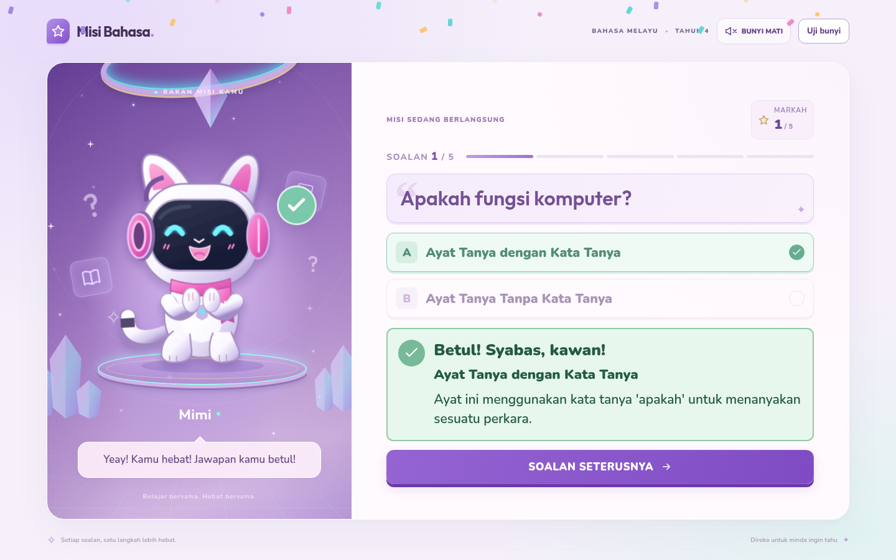
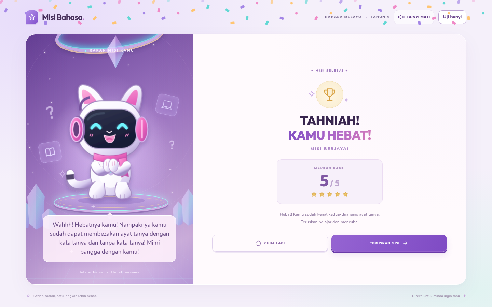

# Mimi 游戏预览 / Pratonton Mimi

这是已经实现并通过浏览器测试的游戏实际截图。当前分支用于预览，不改变 `main`。

## 在线试玩

[打开 Mimi 在线游戏](https://g-ipgp251801465-glitch.github.io/kuiz-jenisayattanya/?v=2)

## 直接查看游戏画面






## 下载试玩

[下载试玩 ZIP](https://github.com/g-ipgp251801465-glitch/kuiz-jenisayattanya/raw/refs/heads/codex/mimi-preview/docs/preview/misi-preview.zip)

解压后，用 Chrome、Edge 或 Safari 打开 `misi-preview.html`。图片、字体、动画、答题逻辑和音效均已包含，无需安装 Node.js。马来语朗读取决于设备提供的语音；所有台词都有文字显示。下一活动链接保持未配置，点击时会显示友好提示。

在线版本由 `gh-pages` 分支发布。

---

# Misi Kenali Jenis Ayat Tanya!

Kuiz Bahasa Melayu Tahun 4 bersama Mimi. Lima soalan, pengiraan markah sekali bagi setiap jawapan, dua penamat (3–5 markah: berjaya; 0–2 markah: ulang kaji), animasi SVG, bunyi Web Audio dan pertuturan `ms-MY`.

## Pembangunan

Node.js 20.19+ atau 22.12+ diperlukan (diuji dengan Node.js 24).

```sh
npm ci
npm run dev
```

Gunakan checkout sedia ada; tugasan awan sudah diasingkan dan tidak memerlukan Git worktree tambahan. Dalam persekitaran yang menyekat cache direktori utama, gunakan `npm ci --cache /tmp/misi-npm-cache`.

## Semakan

```sh
npm test
npm run build
# Jalankan pelayan pembangunan dalam terminal lain dahulu.
npx playwright install chromium
npm run test:e2e
```

Jika Chromium sudah dipasang, gunakan `CHROMIUM_PATH=/usr/bin/chromium npm run test:e2e`. `TEST_URL` boleh menetapkan alamat pelayan ujian lain. Ujian pelayar meliputi keenam-enam jumlah markah, penjelasan setiap soalan, penguncian jawapan, tetapan semula, arahan, kawalan bunyi, panggilan pertuturan Melayu, pautan belum tersedia serta susun atur desktop dan mudah alih. Tangkapan skrin disimpan dalam `.test-results/` (diabaikan Git).

Tiada fail audio luaran diperlukan: semua kesan bunyi menggunakan klip WAV tempatan dengan sandaran Web Audio. Pertuturan menggunakan suara Melayu yang tersedia pada peranti; suara wanita dipilih apabila tersedia. Suara asal Mimi tidak dibekalkan dan suara peranti mungkin berbeza atau tidak tersedia. Semua dialog kekal kelihatan. Ujian automatik mengesahkan panggilan audio dan bahasa pertuturan; semakan pendengaran dengan peranti sasaran masih disyorkan.

## Pautan aktiviti seterusnya

Sunting `public/config.js` sebelum membina:

```js
window.NEXT_ACTIVITY_URL = 'https://alamat-aktiviti-anda';
```

Biarkan kosong sehingga pautan sebenar tersedia. Permainan akan memaparkan mesej mesra dan tidak membuka pautan rosak. Fail `config.js` dalam hasil binaan juga boleh disunting selepas binaan. Jangan letakkan rahsia dalam konfigurasi awam.

## Cloudflare Pages

- Arahan binaan: `npm run build`
- Direktori hasil: `dist`
- Tiada pelayan aplikasi, pangkalan data atau kunci API diperlukan.
- Alternatif CLI: `npx wrangler pages deploy dist --project-name NAMA_PROJEK_ANDA` selepas menyediakan akaun Cloudflare.

Untuk Cloudflare Workers dengan aset statik, gunakan konfigurasi `wrangler.jsonc` yang disediakan dan jalankan `npx wrangler deploy` selepas binaan. Penerbitan memerlukan akaun dan pengesahan pengguna; repositori ini tidak menerbitkan apa-apa secara automatik.

## Benam dalam Google Sites

Selepas menerbitkan, pilih **Sisipkan → Benam → Mengikut URL** dan masukkan URL HTTPS aplikasi. Gunakan nisbah 16:9 di desktop, contohnya 960 × 540. Paparan landskap rendah diskalakan supaya kawalan muat. Pada telefon, kandungan disusun menegak dan boleh ditatal. Untuk kod benaman tersuai:

```html
<iframe src="URL_HTTPS_APLIKASI_ANDA" title="Misi Kenali Jenis Ayat Tanya" width="960" height="540" style="width:100%;aspect-ratio:16/9;border:0;border-radius:20px" allow="autoplay"></iframe>
```

Bunyi bermula selepas murid menekan butang. Jangan tetapkan `X-Frame-Options: DENY` atau dasar `frame-ancestors` yang menyekat Google Sites. Muatkan sumber melalui HTTPS. Permainan disemak dalam pelayar serta iframe tempatan; penempatan dalam Google Sites sebenar perlu disemak selepas URL penerbitan tersedia.

## Aset dan aksesibiliti

Mimi ialah ilustrasi SVG animasi yang dihasilkan untuk aplikasi ini, berpandukan ciri watak dalam rujukan. Semua grafik dan bunyi berfungsi secara setempat. Fon Nunito dan Outfit dibekalkan melalui pakej `@fontsource` berlesen SIL OFL, tanpa permintaan Google Fonts semasa permainan. Kawalan menyokong papan kekunci, maklum balas mempunyai teks dan ikon selain warna, dialog menggunakan elemen asli, serta animasi menghormati `prefers-reduced-motion`.

## Versi pratonton satu fail

```sh
npm run build:preview
CHROMIUM_PATH=/usr/bin/chromium npm run test:preview
```

Hasilnya ialah `preview/misi-preview.html`. Fon, ilustrasi, gaya dan logik permainan terkandung dalam fail HTML ini. Muat turun dan buka dalam pelayar biasa; tiada pemasangan Node.js diperlukan untuk bermain. Pertuturan masih bergantung pada suara peranti. Pelayar yang diurus organisasi mungkin menyekat fail tempatan; dalam keadaan itu, hidangkan fail melalui pelayan HTTP yang dibenarkan. Ujian menghidangkan HTML yang sama melalui HTTP setempat dan mengesahkan bahawa tiada permintaan aset luaran berlaku.

Tangkapan skrin halaman utama, jawapan betul, ulang kaji, kejayaan dan telefon dihasilkan oleh ujian dalam `preview/`. Binaan laman web biasa kekal dalam `dist/`. Lesen SIL OFL Nunito dan Outfit disertakan dalam `public/licenses/`, hasil binaan, serta komen HTML versi pratonton.


## Original artwork integration

The supplied reference images must be uploaded as original file attachments (a ZIP is supported). Place the unchanged background in `src/images/background-original.png` (or `.jpg`) and Mimi in `src/images/mimi-original.png` (or `.jpg`). The app embeds these originals automatically; no generated replacement is needed. Chat-only inline images are not available as source files in this environment.

Native sound-effect playback can be checked with `CHROMIUM_PATH=/usr/bin/chromium npm run test:audio`. This checks actual playback events, audio signal levels and ordering before speech, rather than only checking audio API calls.
