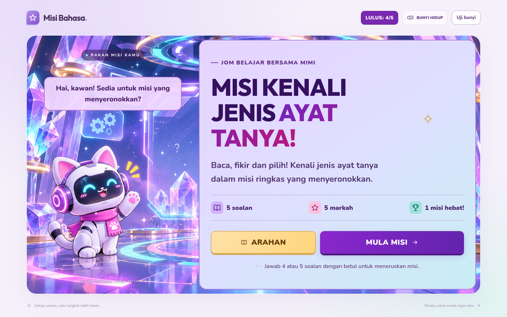
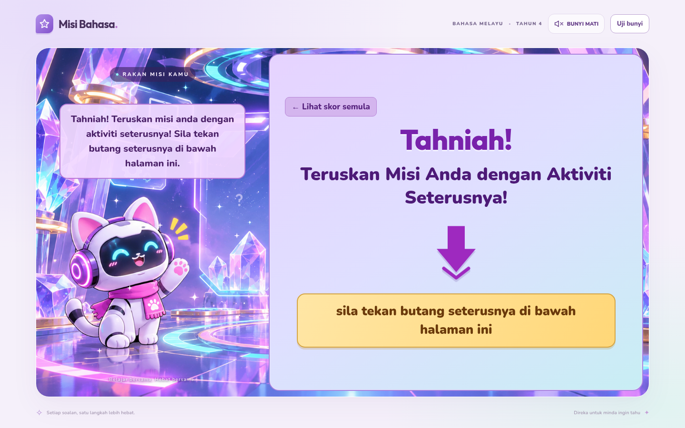

# MISI KENALI JENIS AYAT TANYA!

**正式在线游戏 / Laman rasmi:** https://g-ipgp251801465-glitch.github.io/kuiz-jenisayattanya/play/

适合马来西亚四年级学生的马来语互动测验。五道题、即时解释、一次性计分、成功与复习两种结果。答对 4 或 5 题时，分数页的 **HALAMAN SETERUSNYA** 才会出现并进入独立末页；答对 0–3 题时只能复习及重试。末页显示祝贺文字、持续向下移动的箭头，以及点击所在网页下方活动按钮的提示。**Lihat skor semula** 可返回查看原分数，**CUBA LAGI** 完整重置测验。





## 本地开发

需要 Node.js 20.19+ 或 22.12+，已在 Node.js 24 验证。

```sh
npm ci
npm run dev
```

云环境中继续使用现有 checkout；每个任务已经隔离，无需额外 Git worktree。若主目录缓存不可写，可用 `npm ci --cache /tmp/misi-npm-cache`。

## 构建和测试

```sh
npm test
npm run build
npm run build:pages
```

`npm run build` 输出适用于 Cloudflare Pages 的 `dist/`。`npm run build:pages` 另外生成 GitHub Pages 发布文件 `preview/pages/index.html` 和 `_config.yml`。`npm run build:preview` 生成包含字体、音效和原背景的独立 HTML `preview/misi-preview.html`。

先在另一个终端运行开发服务器，再进行浏览器测试：

```sh
npx playwright install chromium
npm run test:e2e
npm run test:audio
npm run test:art
```

环境已有 Chromium 时可设置 `CHROMIUM_PATH=/usr/bin/chromium`；`TEST_URL` 可指向其他测试服务器。浏览器测试覆盖 0–5 分的全部结果、五题原文与解释、重复点击防护、重置、分数页与末页切换、向下箭头动画和响应式 iframe 布局。音频测试检查实际媒体播放事件、WAV 信号强度、音效先于朗读以及静音。图片测试检查背景保存、恢复和独立 Mimi 图层的移除。

## 原图与音效

原始背景 PNG 保存在 `src/images/background-original.png`，未重新绘制或修改像素，并嵌入正式构建作为可靠的默认背景。背景中已经包含 Mimi，因此不再叠加独立 Mimi 图片。GitHub Pages 中用户上传的横向 PNG 也会在发布时自动列出，图片加载失败时仍保留内置背景。

六个原始 PCM WAV 音效随应用提供，通过原生音频播放，Web Audio 作为备用。马来语朗读使用设备提供的 `ms-MY` 语音；具体音色与可用性取决于设备。每句台词均有可见文字。音频在用户交互后开始，朗读等待音效结束，以免盖住提示音。

Nunito 与 Outfit 字体在构建中自带，SIL OFL 许可证位于 `public/licenses/`，也会包含在独立 HTML 中。游戏不依赖 Google Fonts 请求、外部音效文件、API 密钥或开发会话。

## 正式发布

源码保存在主分支，静态网站由 `gh-pages` 分支经 GitHub Pages 托管。发布时：

1. 运行 `npm run build:pages` 并通过相关测试。
2. 将 `preview/pages/index.html`、`preview/pages/play/index.html` 和 `_config.yml` 更新到 `gh-pages` 的相同路径。
3. 保留该分支已有的原始 PNG 文件；不要添加 `.nojekyll`，因为 Pages 需要在构建时生成原图列表。
4. 推送后检查 GitHub 的 **pages build and deployment** 结果为 **Success**。

正式网址不依赖本地服务器、临时隧道或聊天是否仍在进行。保持 GitHub 用户名、仓库名称和 Pages 设置，避免自行删除仓库或关闭 Pages。GitHub 平台本身的服务可用性仍由 GitHub 负责。

如需在本机试换背景，可打开 `?gambar=1`，直接选择 PNG。此选择只保存在当前浏览器；给所有学生更换背景应将 PNG 上传到 `gh-pages` 或更新源码中的内置原图。

## Google Sites

在 Google Sites 中选择 **插入 → 嵌入 → 按网址**，填写正式网址。桌面建议使用 16:9，已检查 960 × 540 和 800 × 450。

末页提示 **sila tekan butang seterusnya di bawah halaman ini** 指向 Google Sites 页面中位于游戏下方的活动按钮。请在 Google Sites 页面中放置并配置该按钮；游戏不创建或猜测其他活动的网址。

```html
<iframe src="https://g-ipgp251801465-glitch.github.io/kuiz-jenisayattanya/" title="Misi Kenali Jenis Ayat Tanya" width="960" height="540" style="width:100%;aspect-ratio:16/9;border:0;border-radius:20px" allow="autoplay"></iframe>
```

## Cloudflare

Pages 构建命令为 `npm run build`，输出目录为 `dist`。也可用提供的 `wrangler.jsonc` 将 `dist` 部署为 Workers 静态资源；需要在自己的 Cloudflare 账户完成认证。


## Syarat meneruskan misi

Murid mesti menjawab sekurang-kurangnya **4 daripada 5 soalan** dengan betul dan melengkapkan semua lima soalan. Markah 0–3 memaparkan ulang kaji dan **CUBA LAGI** sahaja. Markah 4–5 membuka **HALAMAN SETERUSNYA**. Semakan juga dibuat dalam pengendali halaman akhir supaya peraturan ini bukan sekadar menyembunyikan butang.


## 固定游戏入口与旧缓存

推荐游戏入口为 `/kuiz-jenisayattanya/play/`，页面标有 **LULUS: 4/5**。根入口会自动转到 `/play/`，保留查询参数和片段。发布时必须一起更新两个入口，避免旧书签指向不同规则。

`npm run test:entry` 在本地检查生成的 Pages 文件：旧根入口跳转、查询参数保留、4/5 标记，以及 3 分无法继续和 4 分可以继续。运行前请先执行 `npm run build:pages`。
